

  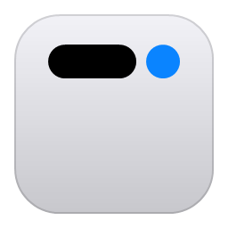

<h1 align="center">ReUI</h1>

The Dynamic Island for Windows.

<!--
  Static badges only: shields.io can't read a private repository. When the repository is
  public, add these dynamic ones:
    https://img.shields.io/github/v/release/ocopus-labs/ReUI                  (latest release)
    https://img.shields.io/github/downloads/ocopus-labs/ReUI/total            (downloads)
    https://img.shields.io/github/actions/workflow/status/ocopus-labs/ReUI/release.yml  (build)
-->

  
  
  
  
  

  <a href="https://github.com/ocopus-labs/ReUI/releases/latest"><b>Download for Windows</b></a>
  &nbsp;·&nbsp;
  <a href="docs/guide.md">Guide</a>
  &nbsp;·&nbsp;
  <a href="CHANGELOG.md">What's new</a>

  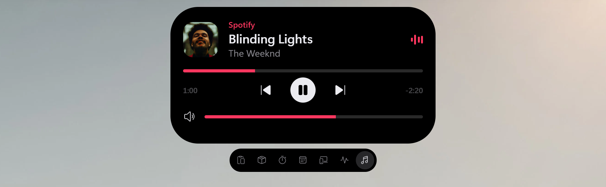

ReUI puts a small black island at the top of your screen. It shows what's playing, what you copied, your timers, your devices and the coding agents waiting on you, and lets you act on them without leaving the window you're in. Rest the pointer on it to peek, click to open, scroll to step through everything that's going on. Clicks pass through to the window underneath until you pause on the island, so it never gets in the way of a browser tab.

It's a native Windows app written in Rust, and it sits idle until something happens: it follows Windows' own events and draws nothing while nothing moves.

## What it does

### Now Playing

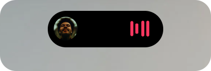

Whatever plays on your PC shows in the pill: Spotify, a browser, VLC, Media Player, anything in Windows' media controls. Open it for the artwork, a timeline you can scrub, the player's own controls and the volume. Swipe sideways on the pill to skip a track. Synced lyrics are there when you turn them on.

### Clipboard history

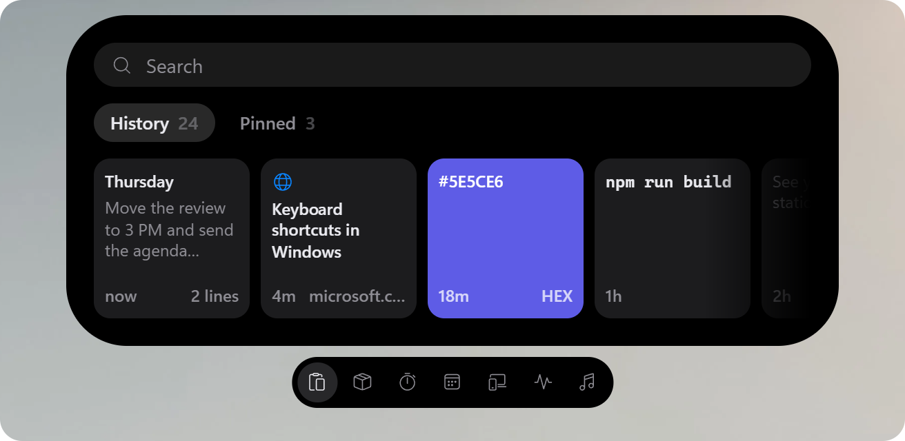

**Win+Alt+V** brings back everything you copied: text with its formatting, images, files, links with their page's title, colours, code. Type to search, press Enter to paste into the app you were in, or Alt+1 to Alt+9 to paste one of the first nine. Pin what you want to keep. Copies from password managers and anything that looks like a password, key or token are never saved, and the history is kept only on your PC.

### Shelf

Drag files, an image, a link or some text to the top of the screen and the island holds them. Collect things from different folders and apps, then drag them back out into a mail, a chat or an upload page, one at a time or all at once. Files never move: the shelf only remembers where they are, and nothing leaves your PC.

### Volume and brightness

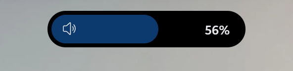

The volume and brightness keys show their level in the island, and ReUI can replace Windows' own pop-up. Drag or scroll to change the level, click the icon to mute, switch the output device from its menu. The mixer button lists every app that's playing under it, each with its own level; click an app's icon to mute just that app. Caps Lock, Num Lock, battery saver and microphone mute can show there too.

### Devices

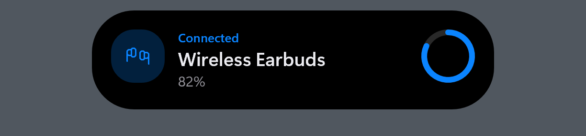

Bluetooth devices show their battery when they connect. Your PC and its devices warn at 20 % and 10 %, plugging in shows the time to full, and USB drives and memory cards come with **Eject**.

### Mic, camera and screen

The moment an app starts using your microphone or camera, or recording your screen, its icon and a coloured dot appear in the island: orange for the mic, green for the camera, purple for the screen. Open it to see every app and since when, and mute the microphone in one click. Settings → Mic & camera.

### Calls

A call in Teams, Zoom, Discord, Slack, Webex, WhatsApp, Telegram or Signal shows in the island with its running time. Open it to mute your microphone or bring the call's window back. ReUI sees the call because the app is holding your microphone, so it works in every app with no plug-in or sign-in. The mute is the microphone's own: nothing reaches the call, even if the app still shows you unmuted. Calls in a browser count if you turn that on.

### System stats

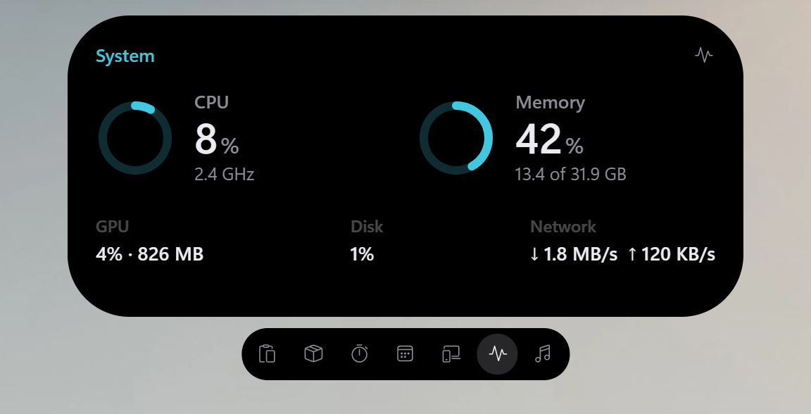

Press **Win+Alt+S** to see how busy your PC is: CPU and memory with their last minute, then GPU, disk and network, live. A number that stays over 90 % turns orange, and the button at the top right opens Task Manager. It reads them only while the card is open, so it costs nothing the rest of the time.

### Downloads and screenshots

A download from your browser shows in the island while it arrives, with its size and speed, then **Open** and **Show in folder** when it's done. Chrome, Edge, Firefox, Opera and Brave all work, and you can add the folders they save to. Take a screenshot with Win+Shift+S or PrtScn and its thumbnail appears with the same buttons, saying when it's already on the clipboard. Settings → Downloads & screenshots.

### Timers and focus

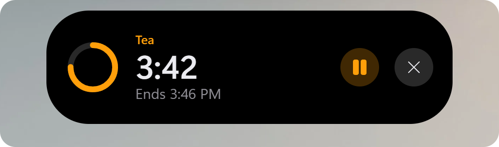

Press **Win+Ctrl+T** and type how long: `10`, `90s`, `1h30`, `10m tea`. Run several at once; they keep going through sleep and restarts, and when one ends the island opens with a sound: **Stop**, or **+1 min**. Type `focus` for focus sessions (25 minutes of work, 5-minute breaks) that can turn on Do Not Disturb while you work, or `sw` for a stopwatch with laps.

### Calendar

Your next meeting comes to the island in its last ten minutes, a ring counting down beside its title. When it starts, the island says so, and **Join** opens the Teams, Zoom, Meet or Webex link found in the invitation, wherever it hides. All-day, declined and cancelled events stay out of the way, and the Calendar view lists what's left of your day. Add your Google or Outlook calendar by its secret iCal address in Settings → Calendar: ReUI keeps it encrypted and asks only your calendar's own server.

### Coding agents

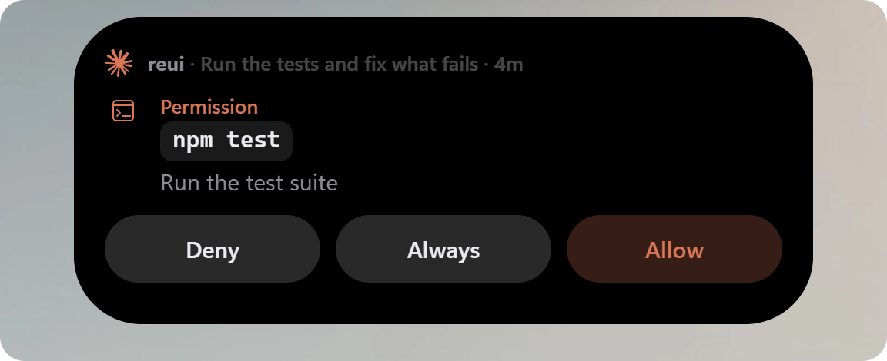

Claude Code, Codex and OpenCode show in the island only when they need you: a permission to allow or deny, a question, a plan or an MCP server's form, a turn that failed. Answer from the island and stay in your editor, or jump straight to the agent's terminal. Each card says which session is asking, shows the full command or the changed lines, and hides anything that looks like a secret. A card never takes your keyboard by itself, so a stray Enter can't allow anything. Connect an agent in Settings → Coding agents.

### Appearance

  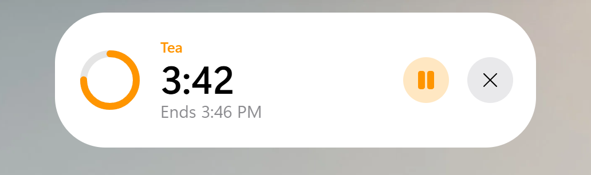
  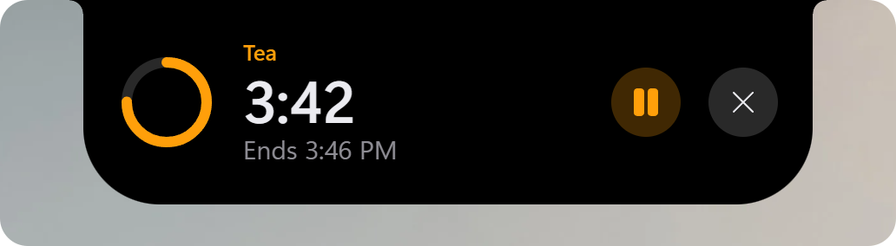

Dark, light, or following Windows' own mode. *Island* floats just below the top edge; *Notch* joins it to the edge like a laptop's notch. Roundness, padding, size and the accent (ReUI blue or your Windows accent) are yours to set, and the island picks up a change at once.

Every feature, shortcut and gesture is in the [guide](docs/guide.md).

## Install

1. Download `ReUI-Setup-<version>.exe` from the [Releases page](https://github.com/ocopus-labs/ReUI/releases/latest).
2. Run it. It installs for your user only, so no admin rights are needed, adds ReUI to the Start menu, starts it with Windows and opens it.
3. Releases aren't code-signed yet, so Windows SmartScreen may say "Windows protected your PC". Choose **More info**, then **Run anyway**.

Running a newer setup upgrades in place and keeps your settings and clipboard history. Settings opens from the tray icon, or by launching ReUI again from the Start menu. Prefer no installer? `ReUI-<version>-x64.zip` on the same page holds the same programs.

## Updates

ReUI checks GitHub for a new version once a day. When one is out, the island says so: **Install** downloads it, checks it against the release's checksums, installs it and restarts ReUI; **Later** puts it off for a day. After an update, Settings → About shows what changed. Turn the check off in Settings → About.

## Privacy

Your clipboard history, settings and logs stay on your PC. There's no account and no telemetry. ReUI goes online for three things only:

- **Link previews:** the title and image of links you copy, from public sites only. Turn them off in Settings → Clipboard.
- **Update check:** once a day, to GitHub. Nothing about you is sent. Turn it off in Settings → About.
- **Synced lyrics:** off until you turn them on; then the song's title, artist and album go to lrclib.net.
- **Calendar:** only once you add a calendar's link; then ReUI asks that calendar's own server for it every 15 minutes. The link and the copy kept for offline use are encrypted for your Windows account.

Settings → Privacy & data lists all of it and opens the folders.

## Uninstall

**Settings → Apps → Installed apps → ReUI → Uninstall.** It stops ReUI, puts back Windows' volume pop-up if ReUI was replacing it, removes the coding-agent hooks it installed, starting with Windows and the Start menu entry, then asks whether to delete your data too.

## Requirements

- Windows 11, or Windows 10 version 2004 or later
- 64-bit (x64)

## More

- [Guide](docs/guide.md): every feature, shortcut and gesture
- [Building from source](docs/development.md): build, flags, files on disk, the coding-agent hooks
- [Changelog](CHANGELOG.md)

## License

Free and open source, under either the [MIT License](LICENSE-MIT) or the [Apache License 2.0](LICENSE-APACHE), at your option.
